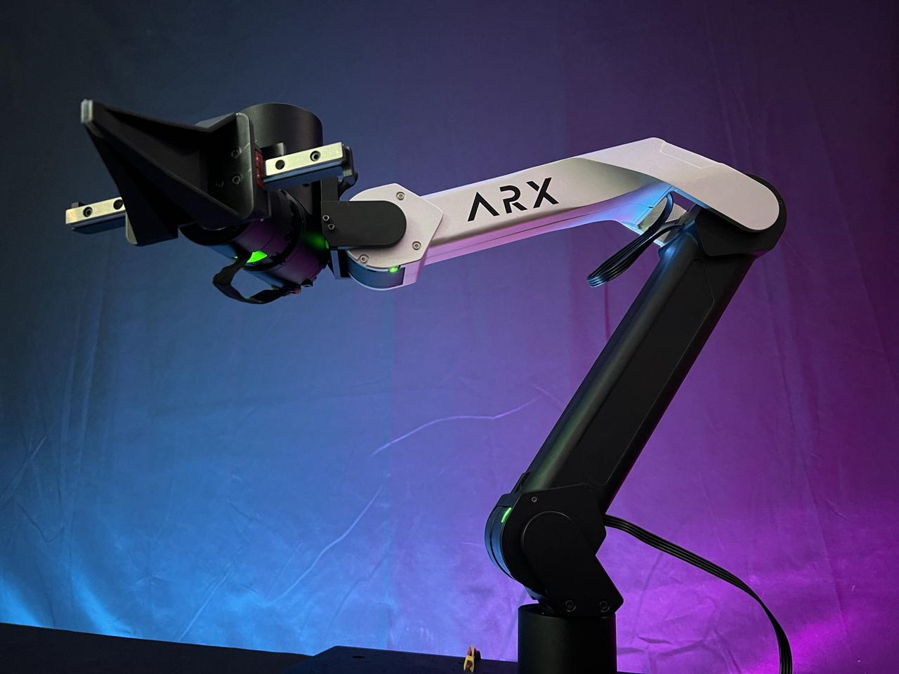
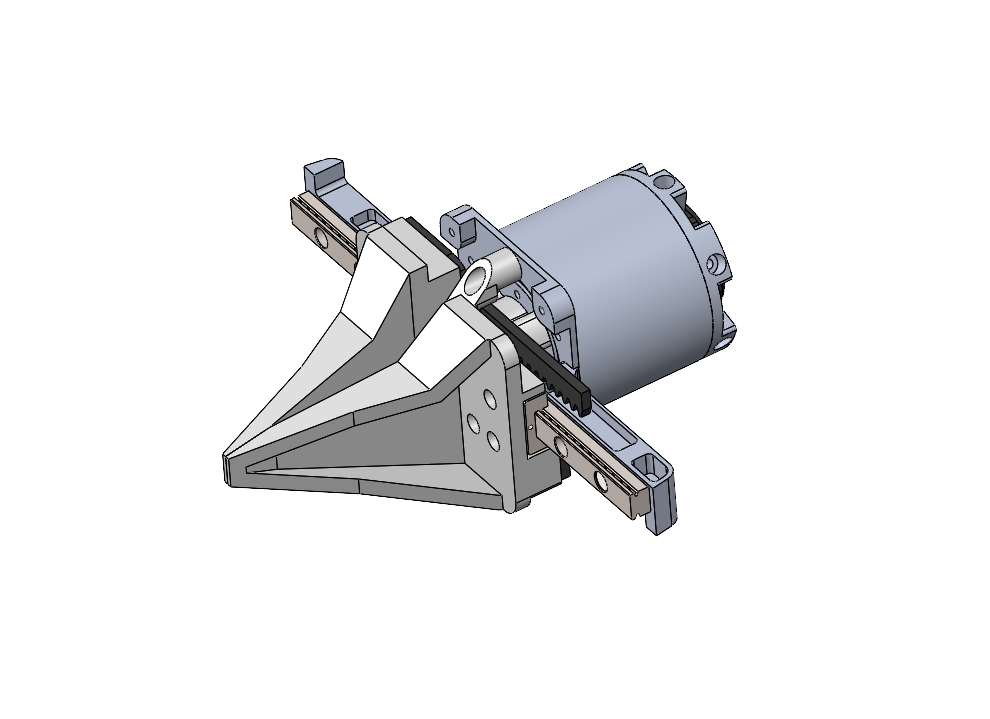
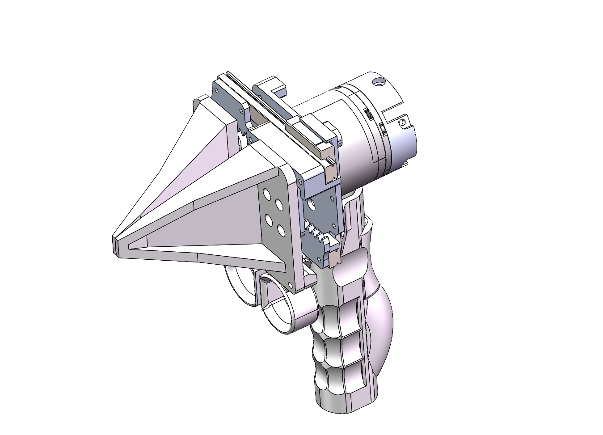
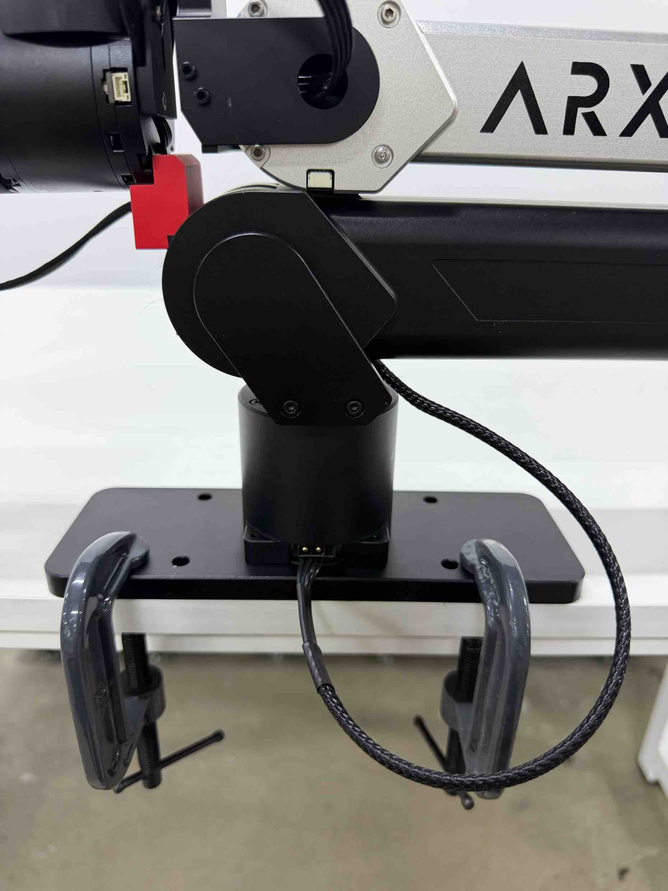
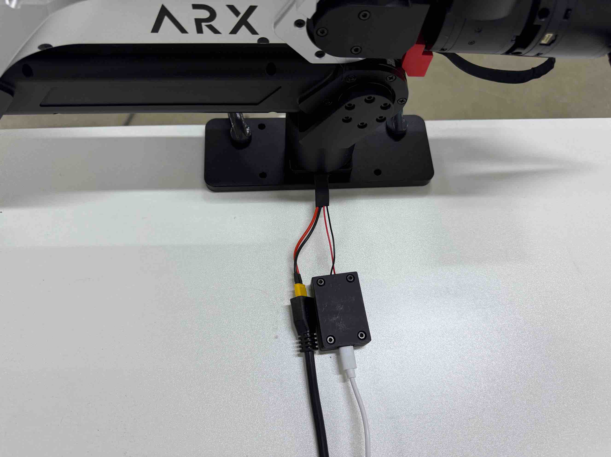
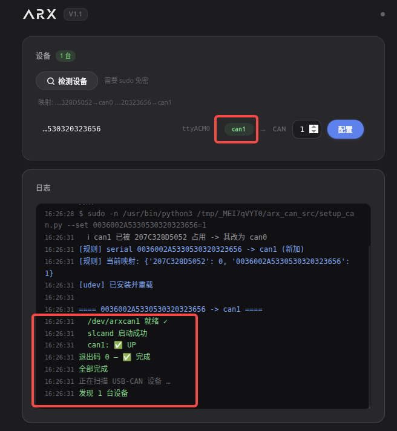
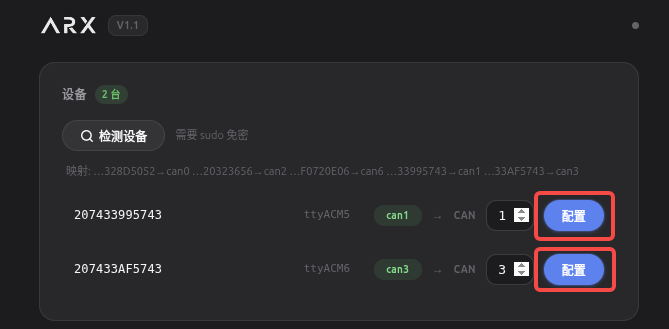
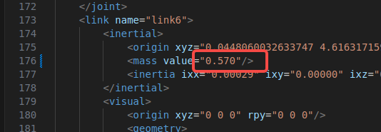
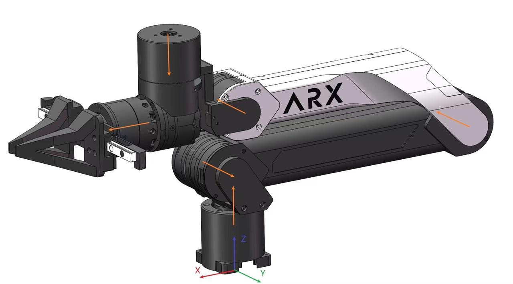
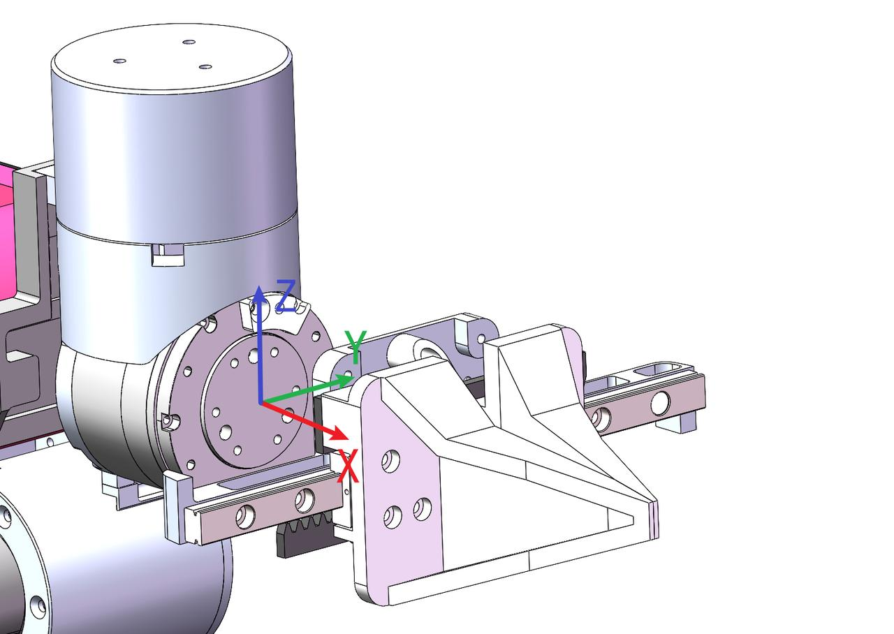

# X5 python SDK\-V2

<div align="center">
  
</div>

使用机械臂时，务必确保安装稳定，以基座为轴心一米半径内确保空旷，当心碰撞易碎物品及造成人员损伤。出现紧急情况请先关闭电源。


只支持ubuntu24\.04    python \>3\.8

# 型号区分

|型号||示意图|区别|
|---|---|---|---|
|X5（2023）|标准单臂<br>||单轨二指夹爪|
|X5（2025）<br>|AC one上机械臂<br>||双轨二指夹爪|

代码中，arm\_cinfig为机械臂参数信息，进入xx\_demo\.py根据具体型号切换type值。

```Python
arm_config: Dict[str, Any] = {
        "can_port": "can1",
        "type": 0,
        # 0>2023  2>2025
    }
```

# 00硬件设备连接

<div align="center">
  
</div>

<div align="center">
  
</div>

# 00环境配置

```Plain Text
sudo apt update
./01_global_nopasswd_sudo.sh.x
./setup.sh        # 装依赖（--mirror 用清华源，国内强烈建议）
```

# A CAN设备

## 配置CAN设备

设备如未更改，只需配置一次即可

多个设备设置时，需要逐个操作。配置完目标后，可以不拔插，直接插入另一个目标进行设置。

逐个插入的目的是区分对应机械臂。左臂建议can1,右臂can3

/ARX\_CAN\_doctor 双击启动

<div align="center">
  
</div>

左臂建议can1,右臂can3

<div align="center">
  
</div>

点击配置后等待日志输出成功配置即可

<div align="center">
  
</div>

依次类推设置其他can设备

## 启动can设备

### 方式A

依次点击doctor中can需要旁边的配置按钮，会进行配置及启动。在can设备不与电脑断连的前提下不会失效。

<div align="center">
  
</div>

### 方式B

进入/start\_CAN目录，启动对应序号

```Plain Text
./arx_can1

//如双臂再启动
./arx_can3
```

# B 运行

```Plain Text
单臂启动为
python3 single_arm_demo.py

双臂启动为
python3 dual_arm_demo.py
```

# SDK

## 0\>夹爪控制

set\_gripper\_pos\(\)  

|类型|夹爪范围|
|---|---|
|X5\-2023|0,5|
|X5\-2025|\-3\.14，0\.1|

## 1\>姿态控制

set\_ee\_pose\_xyzrpy\(xyzrpy,duration=0\)//duraton为到达目标时间，0为最快速度达到，单位s

## 2\>关节位置控制（底层重力补偿）

set\_joint\_positions\(positions=positions,duration=0\) //duraton为到达目标时间，0为最快速度达到，单位s

## 3\>状态反馈

关节反馈（位置，速度，扭矩）\+姿态反馈

### 3\.1 关节位置反馈

get\_joint\_positions\(\)

### 3\.2 关节速度反馈

get\_joint\_velocities\(\)

### 3\.3 关节扭矩反馈

get\_joint\_currents\(\)

### 3\.4 末端位姿反馈

get\_ee\_pose\_xyzrpy\(\) 欧拉角形式

## 4\>重力补偿

gravity\_compensation\(\)

默认值仅含夹爪。加装摄像头等设备后，如遇到末端坠落，或者抬升。请参照\<5\>更改末端质量

若抬升，请调低数值

若下降，请调高数值

## 5\>更改末端质量

Change link6 mass

Remember to save

<div align="center">
  
</div>

若抬升，请调低数值。

若下降，请调高数值。

## 6\>原点位置

### 关节轴向及零点位置

<div align="center">
  
</div>

关节转向符合右手定理，大拇指的指向关节轴向，四指方向就是电机转动的正方向。

此位置为各关节零位。

### 关节范围

|单位度|J1<br>|J2|J3|J4|J5|J6|2023\-gripper<br>rad|2025\-gripper<br>rad|
|---|---|---|---|---|---|---|---|---|
|min|\-150|0|0|\-90|\-90|\-120|0|\-3\.4|
|max|180|210|180|90|90|120|5|0\.1|

### 末端坐标系

<div align="center">
  
</div>

在初始位置，末端坐标系和参考坐标系重合，位置和姿态都是0，如上图所示。


