# X5 python SDK-V2

<div align="center">
  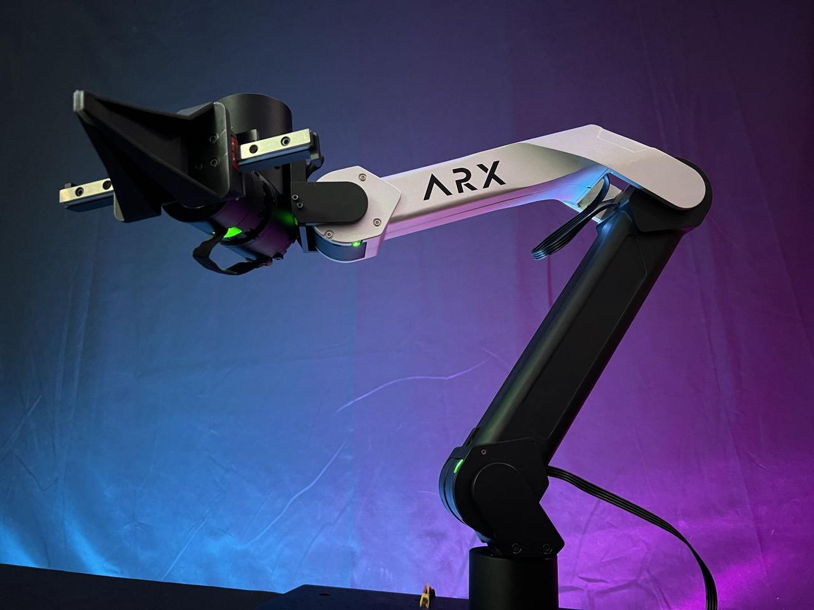
</div>

When operating the robotic arm, make sure it is mounted securely and keep a clear area within a 1.5 m radius around the base. Watch out for collisions with fragile objects and for the risk of personal injury. In an emergency, cut the power first.


Only Ubuntu 24.04 is supported    python >3.8

# Model variants

|Model||Illustration|Difference|
|---|---|---|---|
|X5 (2023)|Standard single arm<br>|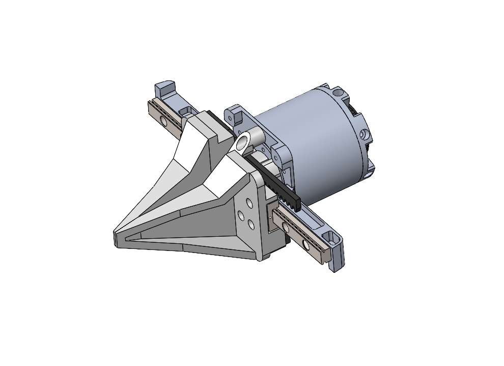|Single-rail two-finger gripper|
|X5 (2025)<br>|Arm on the AC one<br>|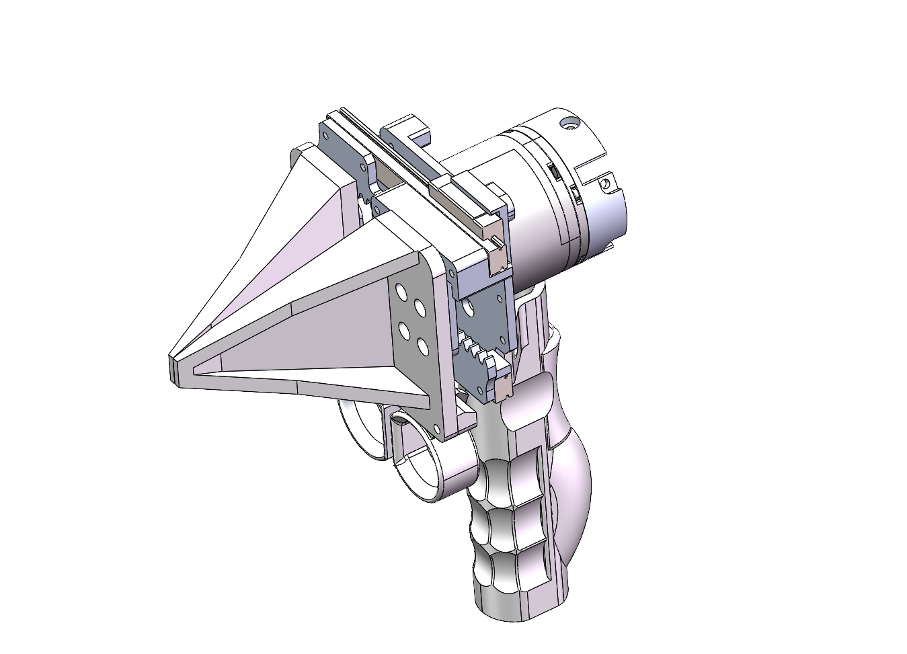|Dual-rail two-finger gripper|

In the code, `arm_config` holds the arm parameters. Open `xx_demo.py` and switch the `type` value according to your model.

```Python
arm_config: Dict[str, Any] = {
        "can_port": "can1",
        "type": 0,
        # 0>2023  2>2025
    }
```

# 00 Hardware connection

<div align="center">
  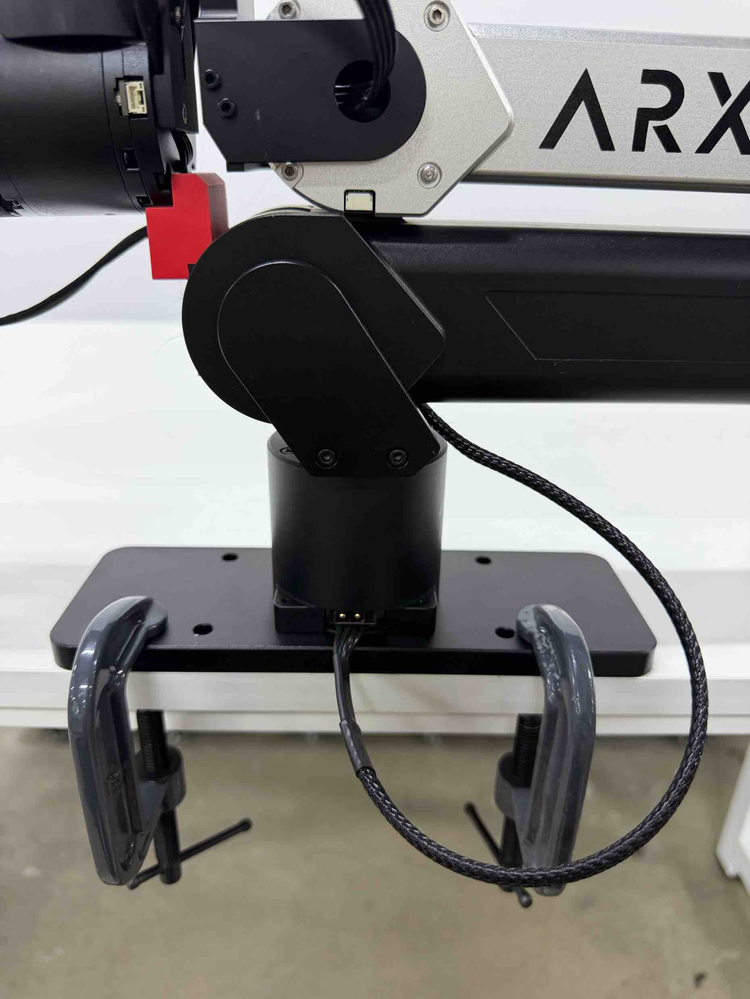
</div>

<div align="center">
  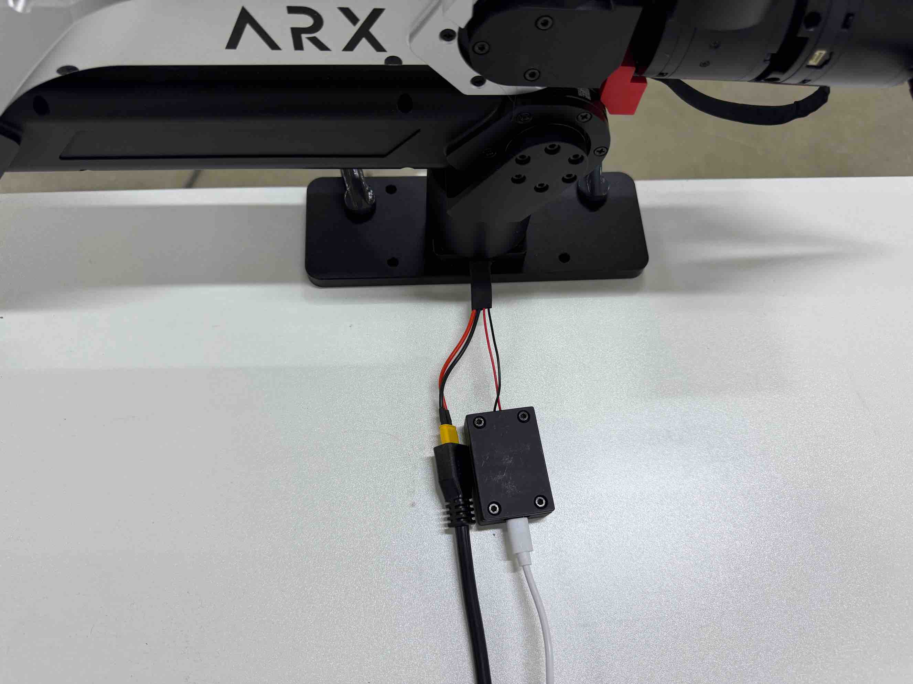
</div>

# 00 Environment setup

```Plain Text
sudo apt update
./01_global_nopasswd_sudo.sh.x
./setup.sh        
```

# A CAN devices

## Configuring a CAN device

Unless the device is changed, this only has to be done once.

When setting up multiple devices, do them one at a time. After configuring one target, you can leave it plugged in and simply plug in the next target to configure it.

Plugging them in one by one is what lets you tell the arms apart. can1 is recommended for the left arm, can3 for the right arm.

Double-click /ARX_CAN_doctor to launch it

<div align="center">
  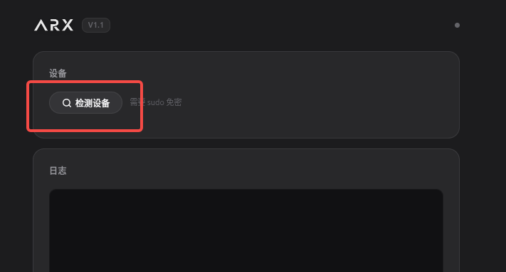
</div>

can1 is recommended for the left arm, can3 for the right arm

<div align="center">
  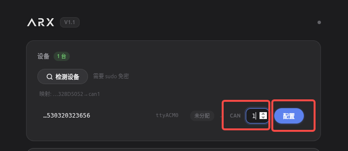
</div>

After clicking Configure, wait until the log reports a successful configuration.

<div align="center">
  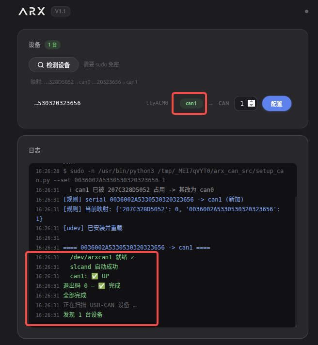
</div>

Repeat for the remaining CAN devices.

## Starting a CAN device

### Method A

Click the Configure button next to the CAN device you need in the doctor; this both configures and starts it. It stays valid as long as the CAN device is not disconnected from the computer.

<div align="center">
  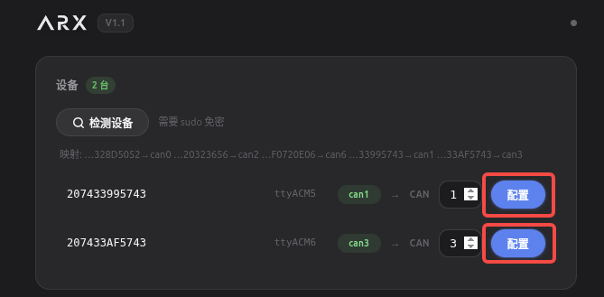
</div>

### Method B

Go into the /start_CAN directory and launch the matching index

```Plain Text
./arx_can1

//for a dual-arm setup, also launch
./arx_can3
```

# B Running

```Plain Text
Single arm:
python3 single_arm_demo.py

Dual arm:
python3 dual_arm_demo.py
```

# SDK

## 0> Gripper control

set_gripper_pos()

|Type|Gripper range|
|---|---|
|X5-2023|0, 5|
|X5-2025|-3.14, 0.1|

## 1> Pose control

set_ee_pose_xyzrpy(xyzrpy, duration=0) // duration is the time to reach the target; 0 means reach it at maximum speed, in seconds

## 2> Joint position control (low-level gravity compensation)

set_joint_positions(positions=positions, duration=0) // duration is the time to reach the target; 0 means reach it at maximum speed, in seconds

## 3> State feedback

Joint feedback (position, velocity, torque) + pose feedback

### 3.1 Joint position feedback

get_joint_positions()

### 3.2 Joint velocity feedback

get_joint_velocities()

### 3.3 Joint torque feedback

get_joint_currents()

### 3.4 End-effector pose feedback

get_ee_pose_xyzrpy() in Euler-angle form

## 4> Gravity compensation

gravity_compensation()

The default value accounts for the gripper only. After mounting a camera or other equipment, if the end effector drifts down or lifts up, change the end-effector mass as described in <5>.

If it lifts up, lower the value.

If it drops, raise the value.

## 5> Changing the end-effector mass

Change link6 mass

Remember to save

<div align="center">
  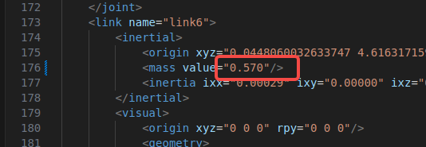
</div>

If it lifts up, lower the value.

If it drops, raise the value.

## 6> Home position

### Joint axes and zero position

<div align="center">
  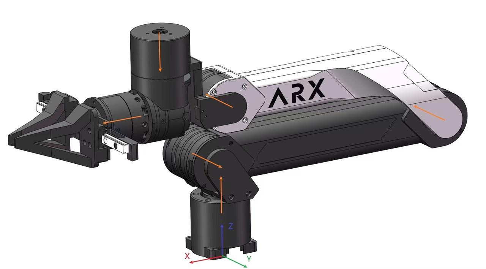
</div>

Joint rotation follows the right-hand rule: the thumb points along the joint axis, and the four fingers point in the positive direction of motor rotation.

This position is the zero position of every joint.

### Joint ranges

|Unit: degrees|J1<br>|J2|J3|J4|J5|J6|2023-gripper<br>rad|2025-gripper<br>rad|
|---|---|---|---|---|---|---|---|---|
|min|-150|0|0|-90|-90|-120|0|-3.4|
|max|180|210|180|90|90|120|5|0.1|

### End-effector frame

<div align="center">
  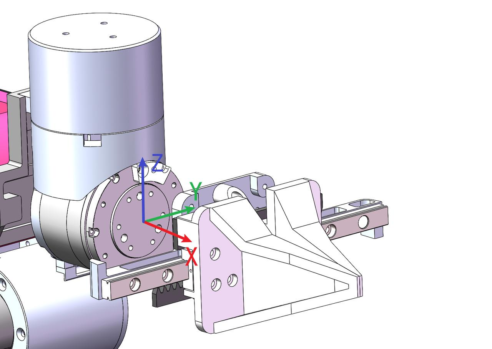
</div>

At the initial position the end-effector frame coincides with the reference frame, so both position and orientation are 0, as shown above.
